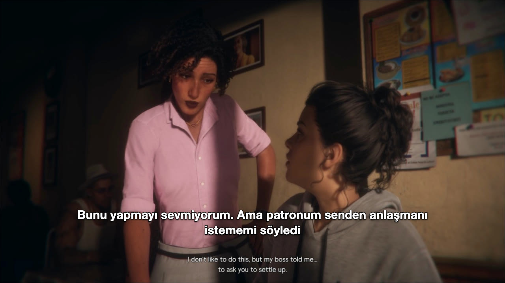
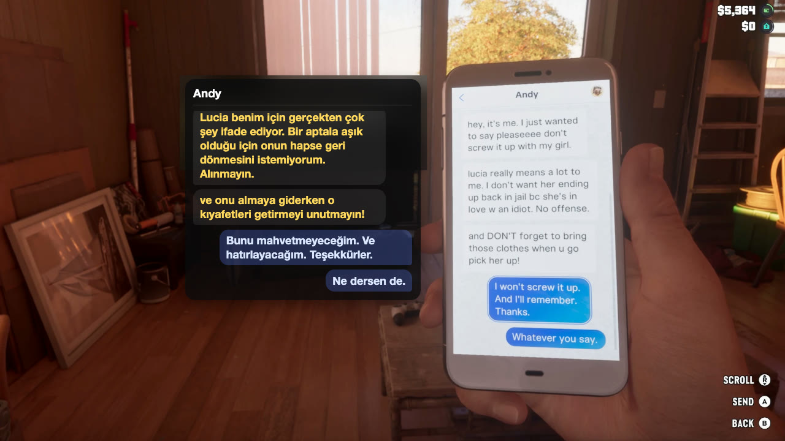
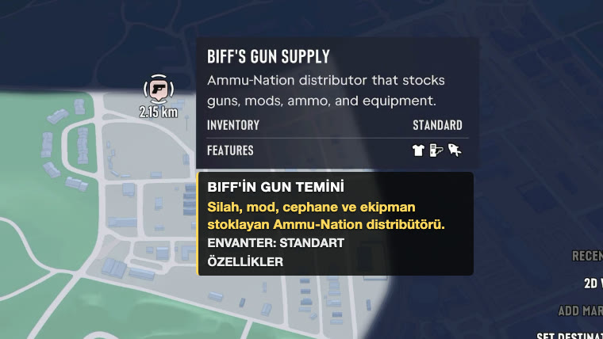
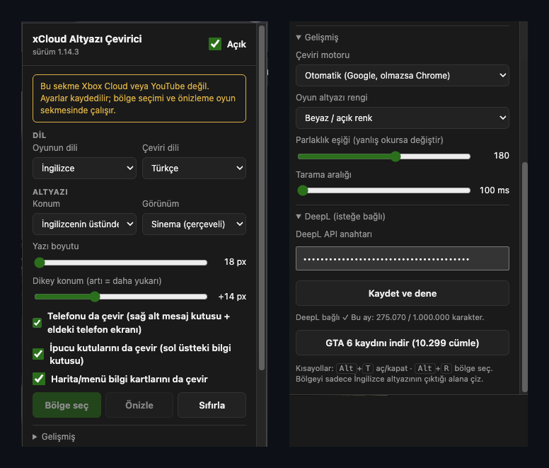

<h1 align="center">Oyun Altyazı Çevirici</h1>

<p align="center">
  Oyunlardaki İngilizce altyazıları ekrandan okuyup <b>canlı olarak Türkçeye çeviren</b> ve sinema altyazısı gibi oyunun üstünde gösteren ücretsiz bir araç.
</p>

<p align="center">
  <a href="https://github.com/setnode/oyun-altyazi-cevirici/releases/latest"></a>
  
  
  
  
</p>

<p align="center">
  <a href="https://github.com/setnode/oyun-altyazi-cevirici/releases/latest"><b>⬇ İndir</b></a> ·
  <a href="#windows-uygulaması">Windows kurulumu</a> ·
  <a href="#mac-uygulamaları">Mac kurulumu</a> ·
  <a href="#chrome-eklentisi-xbox-cloud-gaming">Chrome kurulumu</a> ·
  <a href="#sık-sorulanlar">Sık sorulanlar</a>
</p>

<p align="center">
  
</p>

## Ekran görüntüleri

<table>
  <tr>
    <td width="50%" valign="top">
      <br>
      <b>Telefon mesajları:</b> Elindeki telefonun ekranı okunur, mesajlar konuşma balonları halinde Türkçe gösterilir.
    </td>
    <td width="50%" valign="top">
      <br>
      <b>Harita ve görev kartları:</b> Mekân ve görev açıklamaları çevrilir. Oyundaki özel adlar ("Ammu-Nation") korunur.
    </td>
  </tr>
</table>

<p align="center">
  <br>
  <sub>Chrome eklentisinin ayar paneli: dil, konum, görünüm, yazı boyutu, telefon/ipucu/harita çevirisi ve isteğe bağlı DeepL</sub>
</p>

## Hangi platformlarda çalışır?

Altyazı ekranda göründüğü sürece hangi platformda oynadığın fark etmez:

- **Xbox:** Xbox Cloud Gaming (xbox.com/play), Windows'taki Xbox uygulaması
- **PlayStation:** PS Remote Play, PS5/PS4 görüntüsünü bilgisayara aktaran yakalama kartı programları
- **Bulut oyun servisleri:** GeForce NOW, Amazon Luna ve benzerleri
- **PC oyunları:** Steam, Epic, Rockstar Launcher ve diğerleri
- **Diğer:** Emülatörler, YouTube ve oyun videoları

İki şekilde kullanılır:

| | Nerede çalışır | Ne zaman seçmeli |
|---|---|---|
| **Windows uygulaması** | Ekrandaki her pencere ve her oyun | PlayStation, PC oyunları, Xbox uygulaması, her şey |
| **Chrome eklentisi** | xbox.com/play ve YouTube | Xbox Cloud Gaming'i tarayıcıda oynuyorsan (macOS'ta da çalışır) |
| **setdeniz play (Mac)** | Xbox Cloud Gaming ve Xbox Remote Play, uygulamanın içinde | Mac'te Xbox oynuyorsan: 1440p yayın, çeviri gömülü |
| **Altyazı Çevirici (Mac)** | Mac'teki her oyun penceresi | PS Remote Play, GeForce NOW ve diğerleri |

---

## Özellikler

- **Gecikmesiz çeviri:** Yeni bir cümle genelde yarım saniyenin altında Türkçe olarak ekrana gelir.
- **Bir kez çevrilen cümle bir daha sorulmaz:** Çeviriler bilgisayarında saklanır (20.000 cümleye kadar). Tekrar eden replikler internete gitmeden anında gelir.
- **Oyun sözlüğü:** Sık geçen kısa replikler ve görev hedefleri ("Lose the cops" → "Polisleri ekte", "Wasted" → "Öldün") hazır olarak gelir.
- **Argo ve küfür:** Sokak argosu doğru anlaşılır. Küfürlü kısa ünlemler doğal Türkçe karşılıklarıyla, dozunda çevrilir ("Shut the fuck up" → "Kapa çeneni amk").
- **İsim ve yer koruma:** Karakter adları ("Bill", "Cat", "Lucky") ve oyun içi yer adları ("Vice City", "Port Gellhorn") çevrilmez. Türkçe ekleri doğru alır ("Ambrosia'da", "Moses'le").
- **Görev hedefleri ayrı çevrilir:** "Follow Donnie" → "Donnie'yi takip et"
- **Diğer ekranlar:** Sol üstteki ipuçları, harita ve görev kartları, telefon mesajları da okunur.
- **GTA tarzı konturlu yazı desteği:** Beyaz yazı açık renk zemine (gökyüzü, beton) gelse bile okunur.
- **Hazır GTA 6 çeviri havuzu:** Binlerce replik elle düzeltilmiş çevirisiyle hazır gelir; ilk seferde bile anında gösterilir.
- **İsteğe bağlı DeepL desteği:** Kendi ücretsiz DeepL anahtarını girersen çeviriler arka planda daha doğal olanlarla güncellenir. Ekrandaki altyazıyı hiç geciktirmez.
- **Gizlilik:** Ekran okuma tamamen bilgisayarında yapılır. İnternete yalnızca okunan cümlenin metni çeviri için gider; ekran görüntüsü hiçbir yere gönderilmez.

---

## Windows uygulaması

### Kurulum

1. Sağdaki **Releases** bölümünden en son sürümün `xCloud-Cevirici-Windows.zip` dosyasını indir.
2. Zip'i bir klasöre çıkar.
3. `XCloudCevirici.exe`'ye çift tıkla. Kurulum gerekmez, .NET kurmana da gerek yoktur.
4. "Windows kişisel bilgisayarınızı korudu" uyarısı çıkarsa **Ek bilgi** → **Yine de çalıştır**'a tıkla. Uygulama imzasız olduğu için bu uyarı çıkar.

**Gerekenler:** Windows 10 (2004 ve sonrası) veya Windows 11, 64 bit, internet bağlantısı.

### Kullanım

1. Oyunu aç (Remote Play, Xbox uygulaması, Steam… fark etmez) ve ekrana bir altyazı gelsin.
2. **F9**'a bas, sadece İngilizce altyazının çıktığı alanı fareyle çiz. Alan iki satır sığacak kadar büyük olsun, gereğinden büyük olmasın.
3. **Önizle** ile Türkçe altyazının görünümünü ve yerini kontrol et.
4. **F8**'e bas, çeviri başlar.

| Kısayol | İşlev |
|---|---|
| **F8** | Başlat / Durdur |
| **F9** | Altyazı bölgesini seç |
| **F10** | Çeviriyi gizle / göster |

Kısayollar oyun tam ekrandayken de çalışır.

### Ayarlar

- **Konum:**
  - **İngilizcenin üstünde** (varsayılan): İngilizce kalır, Türkçesi hep aynı yerde üstünde durur.
  - **İngilizcenin altında**
  - **Koyu kutuyla örtülü:** İngilizcenin üstü koyu bir şeritle kapatılır.
  - **İngilizceyi sil, yerine yaz** (deneysel)
- **Görünüm:** "Sinema" (çerçeveli beyaz yazı) veya "Yarı saydam kutu"
- **Yazı boyutu:** Ekranına göre 26–40 arası iyi durur.
- **Dikey konum:** Çevirinin yüksekliğini ince ayarlar (artı = daha yukarı).

> Discord'da ekran paylaşırken "İngilizcenin üstünde" ve "İngilizcenin altında" modları yayında da görünür.

---

## Mac uygulamaları

İki ayrı uygulama vardır. İkisi de Chrome eklentisinin çeviri motorunun aynısını kullanır (aynı OCR, oyun sözlüğü, hazır GTA 6 havuzu, telefon/ipucu/kart çevirisi ve DeepL desteği).

- **setdeniz play:** Xbox Cloud Gaming'i ve kendi konsoluna Xbox Remote Play'i uygulamanın içinde oynatır. Çeviri içine gömülüdür, ekran kaydı izni gerekmez. Yayın sunucusuna 1440p ekranlı bir bilgisayar olarak bağlanır; pencere başlığında anlık çözünürlük, fps ve ağ gecikmesi görünür. Oyunda bir kez çevrilen cümleler hafızaya alınır, sonraki sefer internete gitmeden gelir.
- **Altyazı Çevirici:** PS Remote Play, GeForce NOW gibi başka bir uygulamada oynanan oyunun penceresini okur; Türkçe altyazıyı oyunun üstündeki saydam katmanda gösterir.

### Kurulum

1. Releases'ten `setdeniz-play-Mac.zip` ya da `Altyazi-Cevirici-Mac.zip` dosyasını indir ve çıkar.
2. Uygulamayı **Uygulamalar** klasörüne sürükle.
3. İlk açılışta "geliştirici doğrulanamadı" uyarısı çıkarsa: **Sistem Ayarları → Gizlilik ve Güvenlik** → **Yine de Aç**. Uygulamalar Apple'a ücretli kayıtlı olmadığı için bu uyarı çıkar.
4. Yalnızca Altyazı Çevirici için: **Sistem Ayarları → Gizlilik ve Güvenlik → Ekran ve Sistem Sesi Kaydı**'nda uygulamaya izin ver.

**Gerekenler:** macOS 13 (Ventura) veya sonrası; Apple Silicon ve Intel Mac.

### Kullanım

| Kısayol | İşlev |
|---|---|
| **⌥T** | Çeviriyi aç / kapat |
| **⌥R** | Altyazı bölgesini seç |

Kısayollar oyun öndeyken ve tam ekranda da çalışır. setdeniz play'de aynı işler üst çubuktaki düğmelerden, ayarlar sağda açılan panelden yapılır. Ayrıntılar zip'in içindeki `BENIOKU.txt` dosyasında.

---

## Chrome eklentisi (Xbox Cloud Gaming)

### Kurulum

1. Bu sayfada yeşil **Code** düğmesi → **Download ZIP** ile projeyi indir ve zip'i çıkar. İstersen Releases'teki `chrome-eklentisi.zip` dosyasını da kullanabilirsin.
2. Chrome'da adres çubuğuna `chrome://extensions` yaz.
3. Sağ üstten **Geliştirici modu**nu aç.
4. **Paketlenmemiş öğe yükle**'ye tıkla ve `xcloud-ceviri` klasörünü seç.
5. xbox.com/play sekmen açıksa sayfayı yenile.

### Kullanım

- Oyunu başlat. Sol üstte **ÇEVİRİ: KAPALI** düğmesi çıkar; tıkla ya da **Alt+T**'ye bas.
- Yeşil kesikli çerçeve altyazının okunduğu alanı gösterir. Altyazı başka bir yerdeyse **Bölge seç**'e tıkla (ya da **Alt+R**) ve alanı fareyle çiz.
- Ayarlar için araç çubuğundaki eklenti simgesine tıkla:
  - **Altyazı rengi:** Beyaz değilse "Diğer renkler"i seç.
  - **Parlaklık eşiği:** Yanlış ya da eksik okuyorsa 150–200 arasında dene.
  - **Konum:** İngilizcenin üstünde, altında ya da koyu kutuyla örtülü.
  - **Görünüm:** Sinema veya yarı saydam şerit. **Önizle** ile kontrol et.

### Güncelleme

Yeni sürümü indirip eski klasörün üstüne kopyala. Sonra `chrome://extensions` sayfasında eklentinin ↻ (yenile) düğmesine bas.

Daha ayrıntılı teknik notlar ve sürüm geçmişi [xcloud-ceviri/KURULUM.md](xcloud-ceviri/KURULUM.md) dosyasında.

---

## DeepL (isteğe bağlı)

Uygulama ve eklenti DeepL olmadan da tam çalışır. Daha doğal çeviri istersen:

1. [deepl.com/pro-api](https://www.deepl.com/pro-api) adresinden ücretsiz **DeepL API Free** hesabı aç. Ayda 500.000 karakter ücretsizdir.
2. Hesabındaki anahtarı kopyala.
3. **Windows'ta:** Uygulamadaki "DeepL API anahtarı" kutusuna yapıştır.
   **Chrome'da:** Eklenti simgesi → DeepL bölümüne yapıştır → Kaydet.

Anahtar yalnızca senin bilgisayarında saklanır. DeepL ilk gösterimi hiç geciktirmez: önce hızlı çeviri gösterilir, DeepL'in çevirisi arka planda önbelleğe yazılır ve cümle bir dahaki gelişinde DeepL'den gösterilir.

---

## Sözlüğü kendin geliştir

Oyun sözlüğü `xcloud-ceviri/sozluk.js` dosyasındadır ve Windows uygulamasıyla ortaktır. Herhangi bir metin düzenleyiciyle açıp ekleme yapabilirsin:

- **kisa:** Tam eşleşen kısa replikler. Örnek: `"wasted": "Öldün"`
- **argo:** Google'a gönderilmeden önce argoyu düz İngilizceye çeviren kurallar
- **kalip:** İsimli görev kalıpları. Örnek: "Follow `<AD>`" → "`{1:yı}` takip et"
- **adlar:** Çevrilmeyecek oyun içi yer ve marka adları
- **duzelt:** Çeviriden sonra uygulanan Türkçe düzeltmeler

Değişiklikten sonra eklentiyi `chrome://extensions` sayfasında ↻ ile yenile. Windows uygulamasında değişikliğin geçmesi için uygulamayı yeniden derlemen gerekir.

---

## Kaynaktan derleme (Windows uygulaması)

[.NET 8 SDK](https://dotnet.microsoft.com/download) gerekir. Windows, macOS veya Linux'ta derlenebilir:

```bash
cd windows-app
dotnet publish -c Release -o cikti
```

`cikti/XCloudCevirici.exe` tek dosyalık, kurulum gerektirmeyen uygulamadır.

## Kaynaktan derleme (Mac uygulamaları)

Xcode komut satırı araçları gerekir (`xcode-select --install`):

```bash
cd mac-app
./build.sh zip
```

`build/` klasöründe iki uygulama ve zip paketleri oluşur.

## Klasörler

| Klasör | İçerik |
|---|---|
| `xcloud-ceviri/` | Chrome eklentisi. `sozluk.js` ve çeviri havuzu Windows uygulamasıyla ortaktır. |
| `windows-app/` | Windows uygulamasının kaynak kodu (C#, WinForms, Windows OCR) |
| `mac-app/` | Mac uygulamalarının kaynak kodu (Swift, WebKit, ScreenCaptureKit); çeviri motoru `xcloud-ceviri/` ile ortaktır |
| `havuz/` | Hazır çeviri havuzunu üreten betikler ve elle düzeltilmiş çeviriler |

---

## Sık sorulanlar

**Çeviri hiç çıkmıyor.**
Seçtiğin alanın sadece altyazıyı kapsadığından emin ol. Alan çok büyükse arka plandaki yazılar karışır. Eklentide altyazı rengi ve parlaklık eşiği ayarlarını dene.

**Bazı kelimeler yanlış okunuyor.**
Oyunun altyazı boyutunu büyütmek ve altyazı arka planını (varsa) açmak okumayı çok iyileştirir.

**Hesabıma bir şey olur mu?**
Uygulama oyunun dosyalarına ya da belleğine dokunmaz. Yalnızca ekranın görüntüsünü okur ve üstüne pencere çizer.

---

## Lisans

[MIT](LICENSE). Ekran okuma için kullanılan [Tesseract.js](https://github.com/naptha/tesseract.js) Apache 2.0 lisanslıdır (`xcloud-ceviri/vendor/TESSERACT-LICENSE.md`).

Bu proje Microsoft, Sony, Rockstar Games, Google veya DeepL ile bağlantılı değildir. Oyun ve marka adları sahiplerine aittir.
